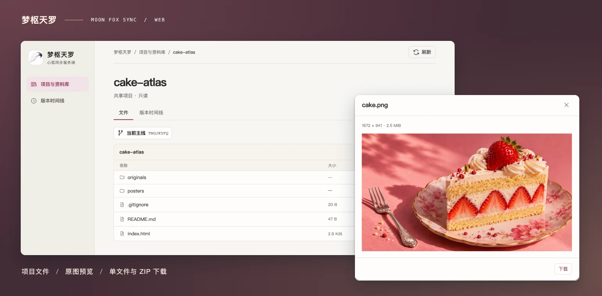

<h1 align="center">心狐同步 · Moon Fox Sync</h1>

<strong>把散落在多台电脑上的项目，连同 Git 忽略的原稿，一起备份到自己的 NAS。</strong>

<a href="https://github.com/Kiriusss/MoonFoxSync/releases/latest">下载发行版</a> · <a href="快速开始.md">安装与配对</a> · <a href="https://github.com/Kiriusss/MoonFoxSync/issues">反馈问题</a>

在笔记本上拉到最新代码，作品集还是少了一张图。海报目录命中了 `.gitignore` 里的规则，原稿只存在书桌电脑上。心狐同步可以把整个工作目录保存成一个快照。换台电脑，打开 NAS 网页就能下载那张图，也能取回上周的整个项目。

桌面客户端负责捕获和传输文件。**梦枢天罗**运行在你的 NAS 上，保存各台电脑共用的项目历史，并提供网页控制台。普通文件夹和单个文件也可以备份。

## 第一次备份与恢复

1. **在 NAS 上准备资料库。** 下载 Linux amd64 服务端，为数据选择持久目录，例如 ZFS 数据集中的专用文件夹。按指南配置 HTTPS，初始化服务、创建资料库，再为桌面设备签发一次性 `sync` 配对码。[NAS 部署命令](快速开始.md#在-nas-上启动梦枢天罗)
2. **在电脑上保存第一个版本。** 安装桌面客户端，输入 NAS 的 HTTPS 地址和配对码。打开「项目 → 导入项目目录」，选择测试项目的上层文件夹，勾选要备份的项目并确认归属。在资料库点「保存快照」，起名为「第一版」，再从队列点「立即同步」。[桌面安装](快速开始.md#安装与开机自启) · [项目导入](快速开始.md#手动统一项目和合并分叉)
3. **亲手把文件取回来。** 在另一台设备用浏览器打开 NAS 的 HTTPS 根地址，用单独签发的 `reader` 配对码登录。在「项目与资料库」打开项目，点文件旁的「下载」。要核对整份备份，在桌面端「版本历史」选「恢复到…」，将第一版恢复到一个新目录，再打开文件确认内容。[网页浏览与下载](快速开始.md#梦枢天罗网页控制台)

## 平时怎么用

- **代码和原稿保存在同一个时间点。** 导入 GitHub 等父目录时，可以逐个选择子项目。新的 Git 项目默认包含未提交的修改以及 Git 忽略的文件，允许逐项排除。Git 提交库与分支引用仍由 Git 管理。桌面端另有「同步远端 Git」按钮，可以核对提交差后推送或快进拉取。[Git 集成](快速开始.md#同步远端-git)
- **换电脑可以接着同一份项目历史。** 两台机器的本地目录可以叫不同的名字，导入时手动选同一个 NAS 项目即可。如果两台设备从同一旧版本继续修改并上传，NAS 会保留分叉。可以预览差异、处理冲突，再合入主线。[多设备关联与合并](快速开始.md#手动统一项目和合并分叉)
- **把大传输留到回家。** 家庭网卡、直连路由与 NAS 身份匹配时，可以自动上传完整项目。通过 Tailscale 外出访问时，默认手动传，也可放行小任务。菜单栏与任务栏托盘都有「立即同步」。同一项目的上传、下载并发可分别设为 1–50 个文件，上传主进度显示整份快照，下方可看各文件的进度与实测速率。[网络策略](快速开始.md#按来源自动同步) · [传输进度](快速开始.md#查看传输进度)
- **旧版本可以单独取回。** 网页可预览文本和常见图片，下载单个文件或所选快照的完整 ZIP。每个受管项目可保留全部、最近若干个或最近若干天的时间点。手动删除时间点前可以预览影响，并重建受影响版本的索引，保留其内容和恢复能力。[版本与保存策略](快速开始.md#恢复时间线保存策略和删除并重建)

需要节省本机空间时，在快照浏览页面用「取回本机」按需打开文件，使用完再「释放缓存」。这个操作只清理应用下载的副本。已绑定工作目录中的原稿会继续留在原位置。[本机副本与缓存](快速开始.md#mac-上保存恢复和释放空间)

## 平台与下载

- **macOS**　Apple Silicon，macOS 14 及以上。打开 DMG，把应用拖入「应用程序」。支持菜单栏、登录自启、备份与恢复。[下载 Mac 版](https://github.com/Kiriusss/MoonFoxSync/releases/download/v0.4.6/MoonFoxSync-0.4.6-Mac-arm64.dmg)
- **Windows**　Windows 10/11 x64，需 .NET Framework 4.8。0.4.7 使用中文安装向导。桌面端提供 WPF 同步概览、可折叠侧栏和可搜索的项目列表。另提供 ZIP，完整解压后运行「心狐同步.exe」。[下载 Windows 安装程序](https://github.com/Kiriusss/MoonFoxSync/releases/latest/download/MoonFoxSync-Windows-x64.msi) · [便携 ZIP](https://github.com/Kiriusss/MoonFoxSync/releases/download/v0.4.7/MoonFoxSync-0.4.7-Windows-x64.zip)
- **NAS**　梦枢天罗服务端发行包面向 Linux amd64，内置网页控制台。已有 NAS 目录也可以登记为只读资料库。[下载 NAS 服务端](https://github.com/Kiriusss/MoonFoxSync/releases/download/v0.4.6/MoonFoxSync-Server-0.4.6-linux-amd64.tar.gz)
- **Android**　提供只读开发版 APK，可浏览授权目录和历史，读取选定文件。当前包使用调试签名。[下载 Android 阅读端](https://github.com/Kiriusss/MoonFoxSync/releases/download/v0.4.6/MoonFoxSync-Android-0.1.1.apk)
- **鸿蒙**　在系统浏览器打开 NAS 的 `/reader/`，以只读权限浏览、读取或下载文件。原生 HAP 仍在规划中。[手机配对与阅读](快速开始.md#手机读取)

发行页提供源码归档及 SHA-256 校验清单。[全部发行包与校验值](https://github.com/Kiriusss/MoonFoxSync/releases)

## 开发

NAS 服务与桌面同步核心使用 Go，Mac 与 Windows 各自提供原生桌面界面。在仓库根目录运行 `go test ./...` 可执行 Go 测试。存储格式、同步协议、恢复语义和各客户端的实现入口见[开发规格](docs/implementation/README.md)。
